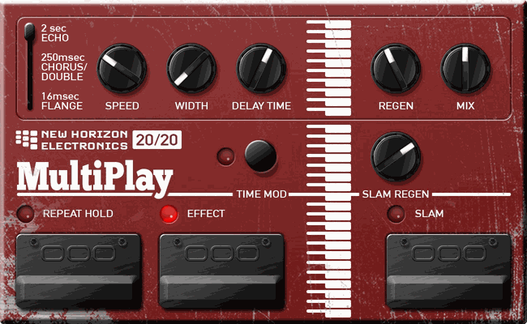

# MultiPlay 20/20

**A 1988 sampler disguised as a delay — now on your MOD.**

MultiPlay 20/20 by New Horizon Electronics recreates the DigiTech PDS 20/20 Multi-Play for MOD Duo, Duo X and Dwarf. It is modelled from the original factory schematics, with two of its owner's hardware mods built in.



## Why it sounds like nothing else

Most delays move a tap. The 20/20 changes the speed of the clock that walks a fixed loop of 8-bit memory. So:

- **Every sweep bends pitch**, like tape.
- **A held loop varispeeds**: freeze it, turn Delay Time, and it dives an octave and more into a grinding low end.
- **Repeats get darker and grittier** on every pass through the 8-bit converters and the NE570 compander.

## Demo
Completely dry (just the plug-in): https://drive.google.com/file/d/1tmwQZ1uhLbevMRAzet1CMWGMjuKDO2nR/view?usp=sharing

The "slam" function to create sustained swells without reverb: https://drive.google.com/file/d/1Lvj3ZzcmT6VHtPw49nYsiMmhGbbbp_oi/view?usp=sharing

Added reverb for sustained choral swells: https://drive.google.com/file/d/1UT3a2G7PX4Z71WNuWXIsXd4HbB-0PjJs/view?usp=sharing

## Controls

| Group | Control | What it does |
| --- | --- | --- |
| Delay | Range lever | 2 s echo · 250 ms chorus/double · 16 ms flange (click a legend line to select it) |
| Delay | Delay Time | Sets the clock, 13:1 across the knob |
| Delay | Time Mod | Doubles every range: 4 s · 500 ms · 32 ms |
| Delay | Regen | Feedback, up to the edge of oscillation |
| Delay | Repeat Hold | Freezes the loop (latching) |
| Modulation | Speed | LFO rate, about 0.07–18 Hz; faster also means shallower, as on the original |
| Modulation | Width | Crossfades from the Delay Time knob to the LFO sweep |
| Expression | Slam | Swaps Regen for Slam Regen while held (momentary by default) |
| Expression | Slam Regen | Feedback level while Slam is held; past 5 it runs away |
| Expression | Ramp Swell Time (settings) | How long Slam takes to swell in, 0.3–3 s; it falls back in twice that |
| Mix | Mix | Dry/wet on both outputs; both full around noon |
| Mix | Output 2 (settings) | Inverted (original) · Normal (mono-safe) · Offset (wide, mono-safe) |
| | Effect | Bypass: echoes muted, delay keeps running, dry at unity |

The footswitches press down while you hold them, and the LED beside each one shows whether it's on. The Time Mod button latches: it stays down, with its LED lit, while Time Mod is on. The plugin's settings list the controls in these four groups.

### Outputs and mono

Mono in, two outputs. The dry signal is the same on both. What Output 2 does with the echoes is a setting:

| Output 2 | Stereo | Both outputs summed to mono |
| --- | --- | --- |
| **Inverted** (default, as the original) | Wide: the echoes are in opposite polarity | The echoes cancel completely |
| **Normal** | Same as Output 1 (no width) | Everything intact, 6 dB louder |
| **Offset** | Wide: Output 2's echoes trail by 12 ms | Echoes intact, with a slight doubling/comb colour |

Playing venues that may sum your stereo rig to mono? Use Normal, or Offset if you want to keep some width.

## Install

**Test builds:** upload `mod-plugin-builder/nhe-multiplay/nhe-multiplay.mk` to <https://builder.mod.audio/buildroot> with your MOD connected over USB, then click Install. Set `NHE_MULTIPLAY_VERSION` in that file to the commit you want to build.

**MOD Plugin Store:** not yet. See [docs/release.md](docs/release.md).

## Build from source

```sh
make                 # builds bin/nhe-multiplay.lv2
make install DESTDIR=/path PREFIX=/usr
```

DPF (DISTRHO Plugin Framework) is a git submodule in `dpf/`, pinned at commit `61d38eb638449647fb8395a35c5b8dab7e981ba7`. Clone with `git clone --recursive`, or run `git submodule update --init --recursive` after cloning. Cross-compile by setting `CC`, `CXX` and `CXXFLAGS` as usual.

Testing, the pedal-face workflow and the release checklist are in [docs/development.md](docs/development.md).

## Repository layout

| Path | Contents |
| --- | --- |
| `plugins/multiplay/` | DSP source (C++, DPF) |
| `bundle/nhe-multiplay.lv2/` | LV2 metadata, pedal face (template, CSS, script, images) |
| `assets/source/` | Source artwork and mockup for the face |
| `mod-plugin-builder/` | Package file for MOD's builder and plugin store |
| `tools/` | Offline LV2 test host, audio test suite, face renderer, interactive face preview (`tools/preview/`) |
| `docs/` | Circuit notes, sound and quirks, development process, release checklist |
| `dpf/` | DISTRHO Plugin Framework, git submodule (ISC) |

## Licence

Code: MIT ([LICENSE](LICENSE)). Artwork: © New Horizon Electronics ([ARTWORK-LICENSE.md](ARTWORK-LICENSE.md)). DPF: ISC ([dpf/LICENSE](dpf/LICENSE)).

DigiTech and Multi-Play are trademarks of their owners. This is an independent recreation, not affiliated with or endorsed by them.
